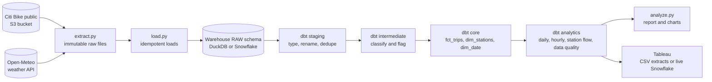
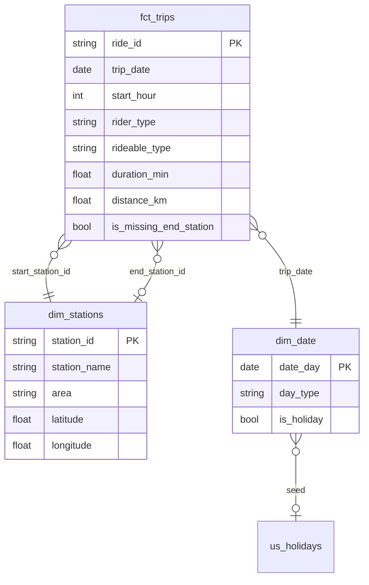

# Citi Bike Jersey City Analytics

An end-to-end data engineering and analytics project on **971,486 real bike-share trips** (Citi Bike Jersey City and Hoboken, October 2025 to September 2026):

**Python ETL → warehouse (DuckDB locally, Snowflake in the cloud) → dbt models and tests → analysis → Tableau dashboard.**

It answers operational questions a bike-share team actually asks: how demand moves with season, hour and weather, and which stations need bikes moved every day.


**Links:**
- [Analysis report](reports/analysis.md)
- [dbt docs and lineage](https://hkandan-hash.github.io/citibike-analytics/)
- [Tableau dashboard guide](tableau/DASHBOARD_GUIDE.md)

## Key findings

Every figure here is computed by [`pipeline/analyze.py`](pipeline/analyze.py) from the dbt marts. See the [full report](reports/analysis.md) for charts and method.

1. **Strong seasonality.** August 2026 had 111,172 trips, 4.3× February's 25,758. Casual riders are 28% of summer trips but 15% in winter.
2. **A commuter system on workdays.** Demand peaks at 8am and 5pm. Weekends have no morning peak, just a midday plateau.
3. **Rain matters more than the raw numbers show.** Wet days average only 7% fewer trips than dry days, but they were also 5 °C warmer. Holding temperature and day type fixed, each millimetre of rain is associated with about 46 fewer trips. Within the same temperature band, wet days have about 25% fewer trips.
4. **Rebalancing need is concentrated.** Ten stations account for 53% of the daily imbalance across 114 stations. Oakland Ave loses about 5 bikes a day, and lost 5 or more on 180 days.
5. **Short hops.** The median trip is 6.2 minutes and 1.1 km. 64% of trips are on e-bikes.

## Architecture



| Layer | Tool | What it does |
|---|---|---|
| Extract | Python | Lists the public bucket to find each month's file. The bucket mixes `.zip` and `.csv.zip` names, so guessing names fails. Downloads are atomic, and files are never modified afterwards. |
| Load | Python + DuckDB / Snowflake | Loads raw text as received. Each file is loaded with delete-then-insert in one transaction and checksummed in `raw.load_log`. Unchanged files are skipped, and re-runs never duplicate rows. Columns are matched by name, so schema drift fails loudly. |
| Transform | dbt | 11 models in staging → intermediate → marts, plus a holiday seed, 39 data tests and source freshness checks. Cross-database macros make the same SQL run on DuckDB and Snowflake. |
| Analyze | Python (pandas, NumPy, matplotlib) | Findings, a regression and four charts, all generated from the marts. |
| Visualize | Tableau | Extract CSVs for Tableau Public, or live Snowflake marts for Desktop and Cloud. See the [build guide](tableau/DASHBOARD_GUIDE.md). |
| CI | GitHub Actions | Unit tests, a one-month end-to-end run on real data with `dbt build`, freshness checks, and `dbt parse` for Snowflake. |

## Data model



The analytics marts are `agg_daily_ridership` (with weather), `agg_hourly_demand`, `agg_station_daily_flow`, `agg_station_summary` and `agg_data_quality`.

## Data quality rules

These rules came from profiling the raw files. Every one is applied in dbt and covered by a test.

| Issue found in the raw data | Rows | Rule |
|---|---:|---|
| Same `ride_id` in two monthly files | 18 | Keep the most recently loaded copy |
| Trip started outside the analysis window (filed late) | 16 | Exclude, reason `outside_analysis_window` |
| Missing start station | 4 | Exclude, reason `missing_start_station` |
| Ended before it started | 7 | Exclude, reason `non_positive_duration` |
| Longer than 24 hours (lost or unreturned) | 561 | Exclude, reason `over_max_duration` |
| No end station (bike not docked) | 5,024 | Keep as a trip; leave out of station-flow figures |
| Station renamed (e.g. JC118) | — | Use the most recent name |

`assert_data_quality_accounts_for_every_row` checks that every raw row ends up as a duplicate, an exclusion with a reason, or a valid trip. `assert_daily_totals_reconcile` checks that the daily mart sums to the fact table.

## Run it locally

Requires Python 3.12. No accounts needed.

```bash
python -m venv .venv
.venv\Scripts\activate          # macOS/Linux: source .venv/bin/activate
pip install -r requirements.txt

python -m pipeline.run all      # extract → load → dbt build → export → analyze (about 1 minute)
pytest
```

Use `--start 2026-06 --end 2026-09` for a different window. Each step runs on its own too: `extract`, `load`, `transform`, `export` and `analyze`.

To use dbt directly:

```bash
cd dbt
set DBT_PROFILES_DIR=.          # macOS/Linux: export DBT_PROFILES_DIR=.
dbt build
dbt source freshness
dbt docs generate && dbt docs serve
```

## Run it on Snowflake

1. Create a [Snowflake trial](https://signup.snowflake.com/) and run [`snowflake/setup.sql`](snowflake/setup.sql). It creates an X-Small auto-suspending warehouse, the database and a role.
2. Set `SNOWFLAKE_ACCOUNT`, `SNOWFLAKE_USER` and `SNOWFLAKE_PASSWORD`. Optionally set `SNOWFLAKE_ROLE`, `SNOWFLAKE_WAREHOUSE` and `SNOWFLAKE_DATABASE`.
3. Run the pipeline against Snowflake:

```bash
python -m pipeline.run extract
python -m pipeline.run load --target snowflake
python -m pipeline.run transform --target snowflake
```

The loader uses `write_pandas`, which stages the data and runs `COPY INTO`. The dbt models are the same; adapter-specific SQL, such as the day-of-week logic, goes through `adapter.dispatch` macros.

## Project layout

```
pipeline/            extract.py, load.py, export.py, analyze.py, run.py (CLI)
dbt/
  models/staging/    stg_citibike__trips, stg_weather__daily, sources + freshness
  models/intermediate/int_trips__classified   (exclusion reasons, derived fields)
  models/marts/core/ fct_trips, dim_stations, dim_date
  models/marts/analytics/ agg_* marts
  macros/            haversine_km, station_area, day_of_week (dispatch), schema naming
  seeds/             us_holidays.csv
  tests/             reconciliation and bounds tests, grain test
reports/             analysis.md + figures (generated)
exports/tableau/     CSV extracts for Tableau (generated)
tableau/             dashboard build guide
snowflake/           account setup SQL
docs/                dbt docs site (GitHub Pages)
tests/               pytest for extract/load
```

## Limitations

- **Snowflake path not run against an account.** CI parses the dbt project for Snowflake, but the Snowflake loader and models have not been run against a live account from this repo. The DuckDB path is fully tested.
- **No Tableau workbook file.** The repo has the extracts and a step-by-step guide, but not a workbook (`.twb`). The dashboard has to be built in Tableau following the guide.
- **Weather is modelled, not measured.** It is ERA5 reanalysis, a gridded model estimate rather than a rain gauge. One year of data cannot fully separate weather from other seasonal effects.
- **Partial view of New York City docks.** Station flow covers only Jersey City and Hoboken docks, because the data only includes trips that touch those areas.

**Data:** [Citi Bike system data](https://citibikenyc.com/system-data) (Lyft, used under the Citi Bike Data License Agreement) and [Open-Meteo](https://open-meteo.com/) (CC BY 4.0).

**Built with:** `Python` · `SQL` · `dbt` · `DuckDB` · `Snowflake` · `Tableau` · `pandas` · `NumPy` · `matplotlib` · `pytest` · `GitHub Actions`
