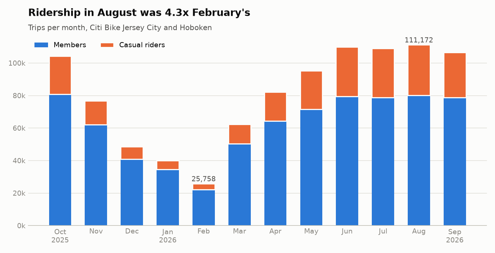
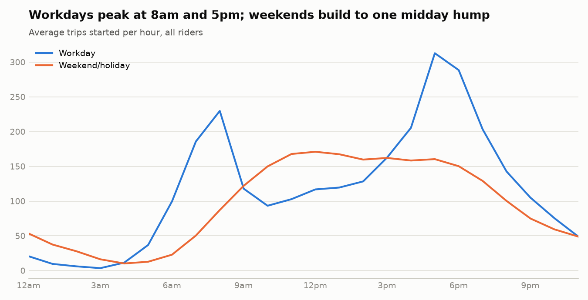
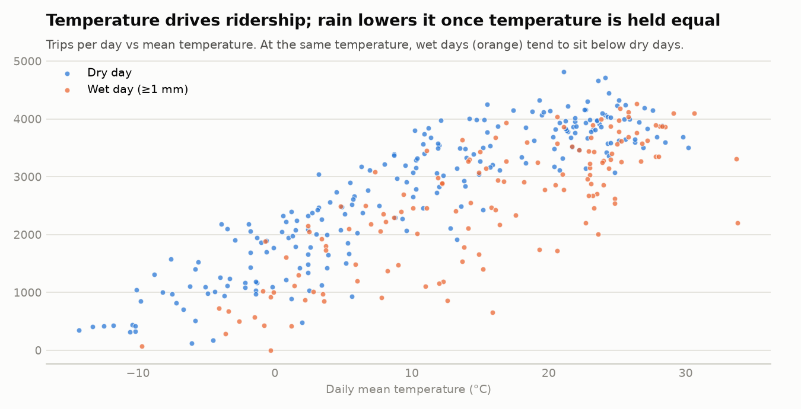
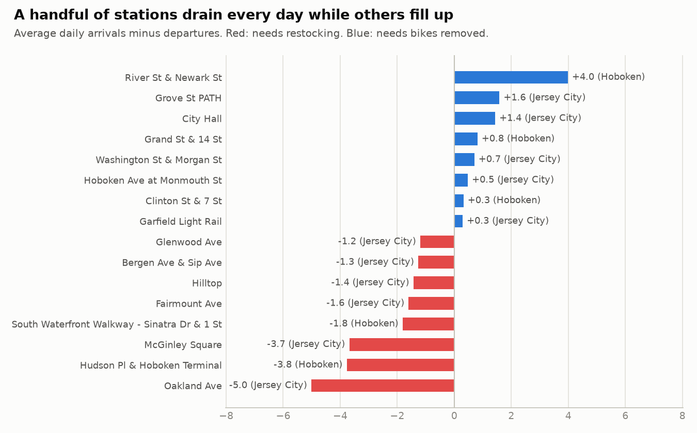

# Citi Bike Jersey City: analysis

Window: October 01, 2025 to September 30, 2026. 971,486 valid trips. Generated by `pipeline/analyze.py` from the dbt marts; every figure below is computed, not hand-entered.

## Key findings

1. **Strong seasonality.** August 2026 had 111,172 trips, 4.3x the low of 25,758 in February 2026. Casual riders are 28% of summer trips but 15% in winter, so the summer surge is disproportionately casual riders.
2. **A commuter system on workdays.** Workday demand peaks at 8am (230 trips/hour) and 5pm (313 trips/hour); weekends and holidays have no morning peak and top out at 171 trips/hour around 12pm.
3. **Rain lowers ridership more than the raw numbers show.** Wet days average 2,542 trips vs 2,734 on dry days, only 7% fewer. But wet days in this period were warmer (15.5 °C vs 10.3 °C), which masks the effect. Holding temperature and day type fixed, each millimetre of rain is associated with 46 fewer trips that day (±7, 95% interval). Comparing wet and dry days within the same 5 °C band and day type, wet days average 25% fewer trips.
4. **Rebalancing need is concentrated.** Of 114 Jersey City and Hoboken stations, the 10 most imbalanced account for 53% of total daily imbalance. Oakland Ave (-5.0/day), Hudson Pl & Hoboken Terminal (-3.8/day), McGinley Square (-3.7/day) drain the most; Oakland Ave lost 5+ bikes on 180 days. River St & Newark St (Hoboken) fills fastest (+4.0/day). Transit hubs appear on both sides (Hudson Pl & Hoboken Terminal drains; Grove St PATH fills), so neither geography nor transit access alone explains the pattern.
5. **Short local hops.** The median trip is 6.2 minutes and 1.08 km. 64% of trips are on e-bikes. 12.7% of trips cross between Jersey City, Hoboken and New York City, and only 0.31% end in New York City.

## Charts

## Weather model

Ordinary least squares on 365 days: `trips ~ temp + temp² + precipitation_mm + weekend_or_holiday`. R² = 0.82.

| term | coefficient | std. error |
|---|---:|---:|
| intercept | 1,852.00 | 42.93 |
| temp_c | 117.15 | 5.22 |
| temp_c_squared | -1.28 | 0.22 |
| precip_mm | -46.15 | 3.33 |
| weekend_or_holiday | -368.87 | 55.13 |

This is correlational. Daily weather comes from ERA5 reanalysis (a gridded estimate, not a rain gauge), and one year of data cannot separate weather from other seasonal changes such as school terms or tourism.

## Data quality

972,092 raw rows were received; 606 (0.06%) were excluded:

| reason | rows |
|---|---:|
| duplicate ride_id across files | 18 |
| started outside the analysis window | 16 |
| missing start station | 4 |
| ended before it started | 7 |
| longer than 24 hours (lost or unreturned) | 561 |

A further 5,024 valid trips have no end station (bike not returned to a dock). They count as trips but are left out of station-flow figures.
